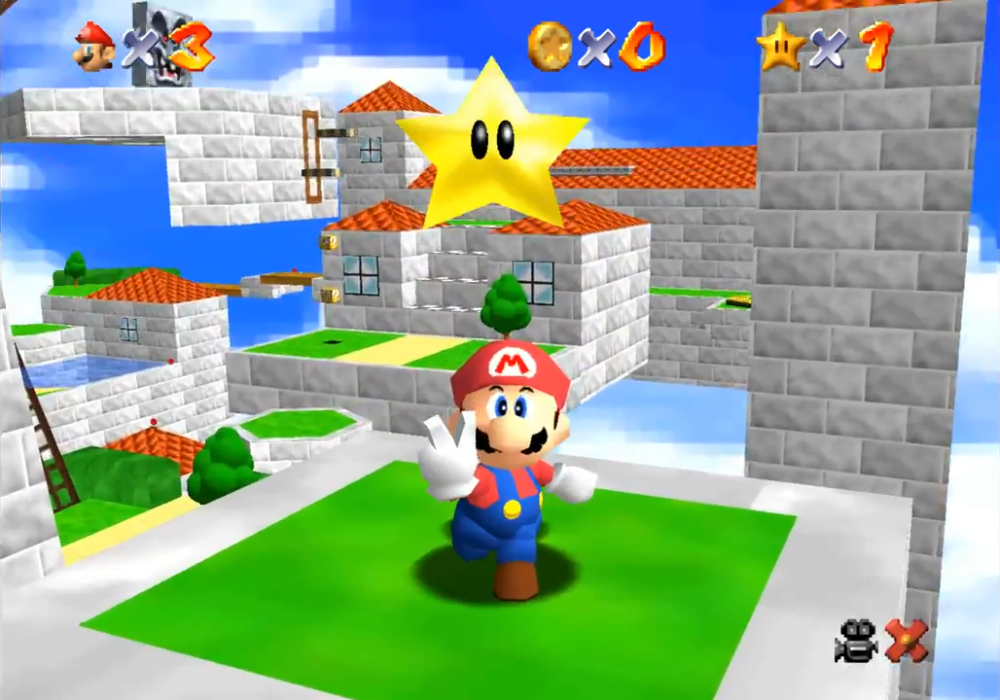

# Referencias e Inspiración

## Descripción de la sección

Registra juegos, películas, libros, fotografías, artículos, diseños o cualquier otra referencia utilizada para tomar decisiones.

## Referencia

**Nombre: Super Mario64**

**Tipo: Videojuego (plataformas 3D)**

**Enlace: [en.wikipedia.org/wiki/Super_Mario_64](https://en.wikipedia.org/wiki/Super_Mario_64)**

**Qué nos interesa: Es considerada la base del género de plataformas 3D. Sirve como referencia para la sensación del movimiento y del salto: su control analógico y sus variantes de salto (incluidos el doble y el triple salto) ayudan a definir cómo debería sentirse el salto y el doble salto de Mochi.**

**Qué NO queremos copiar: La cámara controlada por el jugador (el proyecto usa cámara fija), el catálogo de ataques como puñetazos y patadas (Mochi no ataca) y la libertad de exploración abierta (nuestra progresión es lineal).**

## Referencias visuales

Añade imágenes utilizando la sintaxis de Obsidian:

```markdown

```

## Referencias externas

Puedes utilizar enlaces normales:

```markdown
https://en.wikipedia.org/wiki/Super_Mario_64
```

> [!warning] ⚠️ Propiedad intelectual
> Una referencia sirve para analizar y comunicar una idea. No implica que el proyecto pueda copiar recursos protegidos.

> **Navegación:** [[00 - Índice]] · ← [[01 - Glosario]] · [[03 - Registro de Decisiones]] →
